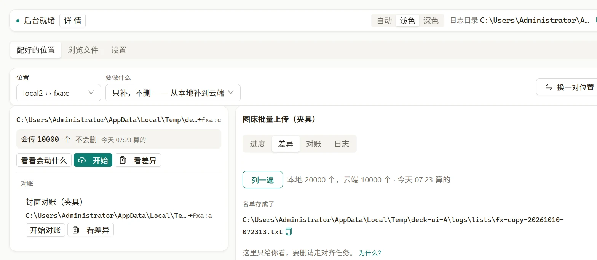

# rclone-deck

> 给 rclone 配一块本机面板：挑好一对位置，先看清这一趟会动哪些、会不会删。

 

<!-- 发布后补这一行（可点的入口）：在线试用 / 下载 / English。仓库还没推上 GitHub，先不写假链接。 -->

面板只在本机跑：它替你管两份配置文件，把要执行的命令交给本机已经装好的 rclone，除了你自己在 rclone 里配的那个远端，没有第二个网络出口。密钥不进这块界面——它读配置时只取键名与非敏感字段，日志落盘前先把值抹掉。（上面这张图跑的是演示夹具那棵树，所以任务名带着「（夹具）」两个字。）

## 支持范围

| 方面 | 范围 |
| --- | --- |
| 系统 | Windows 10 / 11（x64）。其他系统没测过，不写「应该能用」 |
| 依赖 | 本机装好的 rclone（实测钉在 v1.75.1）。面板自己把它拉成后台服务，你不用开命令行 |
| 远端 | rclone 支持哪家就能用哪家（S3 / R2 / WebDAV / 本地目录……），凭据留在 rclone 自己的配置文件里 |
| 界面语言 | 只有中文。所以这里也只放一份中文 README |
| 主题 | 浅色 / 深色 / 跟随系统，两档都按实际渲染出来的色量过对比度 |

## 能做什么

- **一对位置一张卡**：本地目录 ↔ 远端桶配成一张卡。卡上只留两格选择——哪一对位置、要做什么；而「要做什么」那一个选项**自己就是一句完整的话**（`只补，不删 —— 从本地补到云端` / `让两边对齐（会删） —— 以云端为主（删本地多余的）`），不用把好几格拼起来才读得懂要干什么。
- **先看清再动手**：「看看会动什么」只告诉你这一趟会动哪些、不动真格；「看差异」把两边的名字列出来；真要删，确认层会复述一遍方向。
- **会删东西的地方只有两处，两处都先让你看清**：任务那一面只有「让两边对齐（会删）」那一档会删；浏览器那一面的「删掉这一层看到的 N 个」与「清空这一层」是另外两条路，动的就是你点中的那些名字。对齐那一档有两条批准的路：**直接批**（后台动手前仍把这两个位置各列一遍，并过「这一侧空着」与「要删的占比过半」两道拒绝），或先点「重新预览」**把逐条名字看过再批**（那一条还会逐条比对，对不上就不动）。确认层自己复述这一趟的方向与范围，但不要求你手抄一遍授权。「对账」「看差异」是纯只读的，它们报「云端多这一条 / 本地缺这一条」，手不伸。
- **跑完有账**：每一趟落一份任务日志，值先抹掉；跑完那一栏还挂着这次的清单快照，事后能查「当时到底删了什么」。
- **临时试一次不用存**：想试一对没用过的目录，走「浏览文件」，跑完不留在配置里；觉得常用再一键「存成常用」。

## 快速开始

1. 装好 rclone，并用 `rclone config` 把远端配出来（这块界面不管凭据，也不显示它们）。
2. 打开 rclone-deck。**第一次开它会先红一次**：顶栏写「后台没能启动」，因为出厂配置里 `rclone` 的位置留的是占位（面板不替你猜——本机有两份 rclone 时，按 PATH 顺序选第一个是赌博）。去「设置」里「rclone 程序在哪」那一格，填你在终端 `where rclone` 看到的第一条，**重开面板**。之后顶栏那盏灯说「后台就绪」就是起来了。
   端口不用你管：面板自己会挑一个当下绑得上的（名义上是 6400，但 Windows 的动态端口预留会漂，被它盖住时面板会另挑一个）。真要自己钉，设 `RCLONE_DECK_PORT`；顶栏「详情」里那一句永远显示**实际**用的那个号。
3. 在「配好的位置」那一面挑一对位置，要做什么先站「只补，不删」。
4. 按「看差异」，看清要动的是哪些名字。第一次跑建议就停在这儿。
5. 觉得对了再按「开始」。要删东西得把「要做什么」换成「让两边对齐（会删）」，那一档会先开一个确认层把这一趟的范围与方向复述给你；要看逐条名字，按层里那颗「重新预览」。

装的是没做代码签名的包，Windows 会弹「未知发布者」，那是自签证书的正常表现。不想凭信任接受就自己编一份——闸门和构建步骤见 [CONTRIBUTING.md](CONTRIBUTING.md)。

跑完想查账：顶栏「详情」里能打开日志目录，每一趟一份。

## 限制

- **改完配置不热重载**：动过 `jobs.toml` 或 rclone 的配置，要重开面板才生效（面板上也会这么说）。
- **大树要等**：列举是按对象名比对的，六千个对象的目录默认比法实测五十多秒；换成「只比大小」能到十几秒，代价是「内容改了但大小没变」的文件不会再传一次——这一枚开关在界面上会一直说明白。
- **选择不跨重开记住**：重开面板一定回到最轻的那一档「只补，不删」。记住一个会删东西的选择，等于让某天的第一次点击落在最重那一档上。
- **它不是 rclone 的完整前端**：只覆盖复制 / 对齐 / 上传 / 下载 / 改名 / 删这一类日常动作；加密远端、挂载盘这些不管。

## 关于 365 开源计划

[365 开源计划](https://github.com/rockbenben/365opensource) 的第 **#041** 个项目——一个人 + AI，一年 300+ 个开源项目。

[提交你的需求 →](https://365.aishort.top/) · [Discord](https://discord.gg/PZTQfJ4GjX) · [Telegram](https://t.me/aishort_top)
